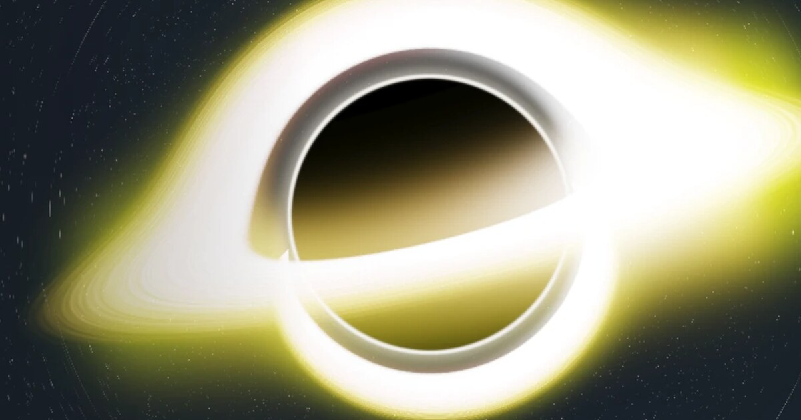

<a id="readme-top"></a>

<div align="center">
  <a href="https://jrmy.ch">
    
  </a>

  <h3 align="center">swaiku · personal website</h3>

  <p align="center">
    A mission-control portfolio built around a real-time procedural planet.
    <br />
    <a href="https://jrmy.ch"><strong>Visit jrmy.ch »</strong></a>
    <br />
    <br />
    <a href="https://github.com/swaiku/portfolio/issues">Report a bug</a>
  </p>
</div>

<details>
  <summary>Table of contents</summary>
  <ol>
    <li><a href="#about-the-project">About the project</a>
      <ul><li><a href="#built-with">Built with</a></li></ul>
    </li>
    <li><a href="#getting-started">Getting started</a>
      <ul>
        <li><a href="#prerequisites">Prerequisites</a></li>
        <li><a href="#installation">Installation</a></li>
      </ul>
    </li>
    <li><a href="#usage">Usage</a></li>
    <li><a href="#project-structure">Project structure</a></li>
    <li><a href="#license">License</a></li>
    <li><a href="#contact">Contact</a></li>
  </ol>
</details>

## About the project

The personal site of Jérémy ("Swaiku"): Master's student in Data Science at HES-SO (Fribourg and Lausanne), working on MLOps, UAV navigation and robotics. It extends my GitHub profile with a telemetry vocabulary ("Mission briefing", "Payload modules", "Active missions", "Transmission log") around a planet that is generated and rendered live in the browser.

- Every visit rolls a new world from a seed: rocky and gas planets, stars, pulsars, black holes, nebulae and comets. Collect them all in the Atlas.
- Terrain, atmosphere scattering, clouds and lensing are computed on the GPU with TSL shaders; no texture is downloaded.
- The render budget adapts to the device: quality tiers, adaptive resolution, and a CSS fallback when there is no usable GPU.
- All the facts about me live in [`src/data/site.ts`](src/data/site.ts).

<p align="right">(<a href="#readme-top">back to top</a>)</p>

### Built with

- [Astro](https://astro.build) (static build) with [Svelte](https://svelte.dev) islands
- [Three.js](https://threejs.org) (WebGPU renderer, WebGL 2 backend by default) and [Threlte](https://threlte.xyz)
- [Tailwind CSS](https://tailwindcss.com) and [GSAP](https://gsap.com)
- [Bun](https://bun.sh)

<p align="right">(<a href="#readme-top">back to top</a>)</p>

## Getting started

### Prerequisites

- [Bun](https://bun.sh)
- A browser with WebGL 2 to see the planet (without it, the page shows a CSS stand-in)

### Installation

1. Clone the repo
   ```sh
   git clone https://github.com/swaiku/portfolio.git
   cd portfolio
   ```
2. Install the dependencies
   ```sh
   bun install
   ```
3. Start the dev server on <http://localhost:4321>
   ```sh
   bun run dev
   ```
4. Build the static site into `dist/` and preview it
   ```sh
   bun run build
   bun run preview
   ```

<p align="right">(<a href="#readme-top">back to top</a>)</p>

## Usage

Query parameters for development:

| Parameter | Effect |
| --- | --- |
| `?debug` | Opens a tweak panel with a frame-rate graph and live controls |
| `?planet=B7B0A5` | Loads the world with this hexadecimal seed |
| `?kind=quasar` | Forces a class of world (`quasar`, `cold` and `singularity` are black holes) |
| `?bake=1024` | Overrides the texture size, useful on slow GPUs |
| `?gpu` | Opts into the WebGPU backend instead of WebGL 2 |

<p align="right">(<a href="#readme-top">back to top</a>)</p>

## Project structure

```
src/
├── components/   Svelte islands: planet scene, HUD, Atlas
├── data/         Site content (profile, missions, skills)
├── layouts/      Base layout and meta tags
├── lib/planet/   World generation, baking and TSL shaders
├── pages/        The single page
└── styles/       Global CSS and design tokens
```

<p align="right">(<a href="#readme-top">back to top</a>)</p>

## License

The code is licensed under the [GNU AGPL-3.0](LICENSE): you may use and modify it, but any modified version you run or distribute must be published under the same license, with credit.

The personal content is not covered by it and stays all rights reserved: the text and facts in [`src/data/site.ts`](src/data/site.ts), my CV information and the `public/og.jpg` image.

<p align="right">(<a href="#readme-top">back to top</a>)</p>

## Contact

Jérémy ("Swaiku") · [LinkedIn](https://www.linkedin.com/in/prinjeremy) · [GitHub](https://github.com/swaiku) · <https://jrmy.ch>

<p align="right">(<a href="#readme-top">back to top</a>)</p>
